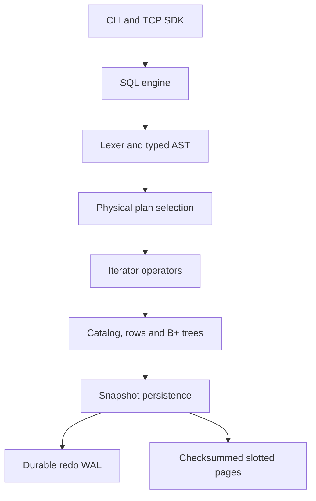

# NexDB 0.2.1

An original relational database engine in TypeScript: binary slotted pages, a persistent catalog, SQL parsing, B+ tree indexes, transactions, a redo log, a TCP server and client, and an interactive shell. No third-party database or ORM implements storage.

**This is an experimental first milestone, not a production database or completion of the full roadmap.** It demonstrates the internals with executable tests. The full catalog and rows are loaded into memory; each write transaction rewrites a database snapshot. Use disposable development data.

## Quick start — Windows PowerShell

Install Node.js 24 or newer and pnpm 11. Extract this archive, then open a terminal in the `nexdb` folder:

```powershell
pnpm install
pnpm build
pnpm test
pnpm nexdb init ./mydb
pnpm nexdb ./mydb
```

Linux also needs `flock` from util-linux. Windows uses a named-pipe process lock. Linux was tested here; Windows code and the CI workflow are provided but were not executed in this build session. macOS is not supported by the current process-lock adapter.

At the prompt, enter one statement at a time, ending with a semicolon:

```sql
CREATE TABLE users (
  id BIGINT PRIMARY KEY,
  username VARCHAR(100) NOT NULL,
  email VARCHAR(255) UNIQUE,
  age INT
);
INSERT INTO users VALUES (1, 'george', 'george@nexdb.dev', 25);
SELECT * FROM users WHERE id = 1;
CREATE INDEX idx_users_email ON users(email);
EXPLAIN SELECT * FROM users WHERE email = 'george@nexdb.dev';
```

Type `.exit`, run `pnpm nexdb ./mydb` again, then `SELECT * FROM users;`. Both the record and index definitions survive. A UNIQUE constraint already creates an email index, so EXPLAIN may select that index instead of the redundant explicit index.

## Shell commands

`.tables`, `.schema`, `.indexes`, `.stats`, `.checkpoint`, `.help`, `.exit`. Multiline SQL and in-session readline history are supported. Persistent command history and database switching are not implemented. The path identifies one database; TCP exposes it as `main`.

## Server and SDK

```powershell
$env:NEXDB_PASSWORD = 'replace-with-a-long-local-password'
$env:NEXDB_DATA = './mydb/main.ndb'
pnpm server
```

Stop the embedded shell first: the same database cannot be opened by two processes. The server binds to `127.0.0.1:7432`. On Linux, prefix the command with `NEXDB_PASSWORD='...' NEXDB_DATA='./mydb/main.ndb'` instead of PowerShell assignments.

From the repository, see `examples/client.ts`:

```ts
import { NexDB } from "./packages/client/src/index.ts";
const db = new NexDB({ user: "admin", password: process.env.NEXDB_PASSWORD! });
await db.connect();
const result = await db.query("SELECT * FROM users WHERE id = ?", [1n]);
console.log(result.rows);
db.close();
```

Run the provided example with `pnpm example:client`. The workspace client package is `@nexdb/client`; publishing it as a standalone npm package is a future packaging task. Parameter values are transported separately and evaluated as AST parameters; there is no string interpolation.

## Implemented SQL

| Area         | Supported                                                                    |
| ------------ | ---------------------------------------------------------------------------- |
| DDL          | CREATE TABLE, DROP TABLE, CREATE [UNIQUE] INDEX, DROP INDEX                  |
| DML          | INSERT with multiple rows/column lists, SELECT, UPDATE, DELETE               |
| Expressions  | comparisons, arithmetic, AND/OR/NOT, IS [NOT] NULL, parameters               |
| SELECT       | WHERE, single-column ORDER BY, LIMIT, OFFSET, DISTINCT, AS                   |
| Constraints  | single-column PRIMARY KEY, UNIQUE, NOT NULL, literal DEFAULT                 |
| Transactions | BEGIN, COMMIT, ROLLBACK                                                      |
| Plans        | EXPLAIN SELECT, equality IndexScan or SequentialScan                         |
| Values       | INT32, signed BIGINT64, FLOAT, BOOLEAN, TEXT, VARCHAR, DATE, TIMESTAMP, BLOB |

Identifiers are unquoted and case insensitive. Strings use SQL single-quote escaping. Dates are ISO strings; timestamps require a timezone. Use parameters for BLOBs and BIGINTs from application code. SQL NULL has three-valued logical semantics. Duplicate non-null unique values fail within the engine. Mutation errors do not retain partial statement changes.

Not implemented: ALTER TABLE, CREATE DATABASE/USE, CREATE USER, grants/roles, JOIN, GROUP BY, HAVING, aggregates, foreign keys, CHECK, named prepared statement handles, EXPLAIN ANALYZE or a cost-based optimizer.

## Architecture



Packages separate shared values, pages, buffer pool, catalog, parser, planner, executor, indexes, WAL, recovery, transaction lock, protocol and client. `PageStore`, `FileLease`, typed plans and encoded tuples form replaceable boundaries. The BufferPool services startup page reads and is independently tested for pinning, dirty eviction and flushing. Queries currently operate on deserialized in-memory rows; buffer statistics are **not** query-cache statistics.

## Transactions and recovery

BEGIN creates a private working catalog. Each modifying statement uses a candidate copy, validates types/constraints and rebuilds affected indexes before acceptance. COMMIT serializes the catalog and indexes into pages, appends a checksummed full-image WAL record, synchronizes WAL, and only then writes and synchronizes the database file. Autocommit uses the same path. ROLLBACK discards private state.

Recovery validates WAL framing/checksums and replays the last complete image. Incomplete final records are truncated; checksum failures stop startup. Uncommitted changes were never written, so undo is discard rather than ARIES-style physical undo. `.checkpoint` synchronizes the data file and truncates WAL. There is no automatic checkpoint schedule; WAL grows until checkpointed.

The server holds a whole-database exclusive lock until a transaction commits, rolls back or disconnects. This conservatively serializes all clients, including readers. Lock waits time out after five seconds; a connection idle for 30 seconds is closed. This is not row-level two-phase locking or MVCC. The embedded API is one session and serializes its own calls; do not share an explicit transaction across unrelated callers.

SIGKILL tests exercise uncommitted discard and committed redo after WAL sync but before data-file application. These are process-crash guarantees under a working filesystem. Power-loss durability, storage-controller behavior, filesystem faults, and exhaustive crash points are not certified. The database and WAL must be kept together; do not back up only the data file while the database is running.

## Security and operating limits

The TCP server is intended for loopback development. It authenticates a single administrator using scrypt and a timing-safe comparison; the password is supplied through the environment and no plaintext credential file is created. All authenticated clients have full privileges. There is no TLS, RBAC or persistent user catalog. Do not expose this server to an untrusted network.

Requests use validated, 1 MiB length-prefixed frames. Handshake timeout is 10 seconds, maximum connections is 100, and at most 32 requests can queue on a connection. Responses larger than 1 MiB fail: use LIMIT. Credentials are never logged by this code. Data/WAL files are created with mode 0600 on POSIX; use a private data directory and platform access controls.

Serialized records up to 16 MiB (including metadata) now span checksummed overflow pages. This applies to rows and index nodes. Small records retain the v0.1 layout. No compression or separate large-object store exists. TCP frames remain limited to 1 MiB, so the storage limit does not imply a 16 MiB network request limit. A snapshot is limited to 256 MiB. Sort and DISTINCT use memory. B+ trees split during insert, but delete/update rebuild trees rather than performing local merge/redistribution. Index nodes persist as binary catalog records, not JSON files or persistent JavaScript Maps.

## Development and validation

```sh
pnpm typecheck
pnpm lint
pnpm test
pnpm test:integration
pnpm test:recovery
pnpm benchmark
pnpm build
```

Vitest runs the integration harness, which launches the Node test runner for isolated crash tests. `pnpm test:native` runs those tests directly. See `docs/verification.md` for the actual checks executed. CI is provided; no remote CI run is claimed. Benchmarks print elapsed times for one machine and do not compare NexDB to mature databases.

## Documentation and next work

See the `docs` folder for binary formats, transactions, plans, security, recovery, and the Rust migration boundary. `docs/roadmap.md` explicitly distinguishes delivered behavior from unfinished phases. The original specification is preserved in `docs/original-specification.txt`.

Next engineering work: incremental heap updates; page-local B+ tree deletion/rebalancing; page-level WAL/LSNs and a recovery fault matrix; shared/exclusive lock management; ALTER/joins/aggregates; persistent users and authorization; richer observability; then Studio. Rust implementation is intentionally deferred until these TypeScript contracts are stable.

## Version 0.2.0 — larger persistent records

Overflow storage removes the old 4060-byte record ceiling. Existing v0.1 databases can be opened directly; preserve a backup before upgrading. Once overflow records are written, use v0.2 or later to open that database; do not downgrade it to v0.1. The engine still rewrites full snapshots and remains experimental.

Run `pnpm example:overflow` for a local demo that writes large text and a binary value, checkpoints, reopens the database, and verifies their contents. It uses and removes a temporary directory.

## Version 0.2.1 — Windows compatibility fixes

Normalizes the lock identity consistently before and after database creation. WAL files use read/write handles and explicit append offsets so Windows checkpoints can truncate them. Crash tests require a synchronous crash-point marker and account for Windows exit-code reporting, while retaining recovery-data assertions. Cleanup closes file handles explicitly on test failures. Added cross-process lock and checkpoint/reopen/torn-WAL append regression tests.

Verified on Linux: 28 tests, typecheck, lint, build and overflow demo. Windows execution is pending; this release addresses the failures reported from Windows v0.2.0 without claiming a Windows pass.
